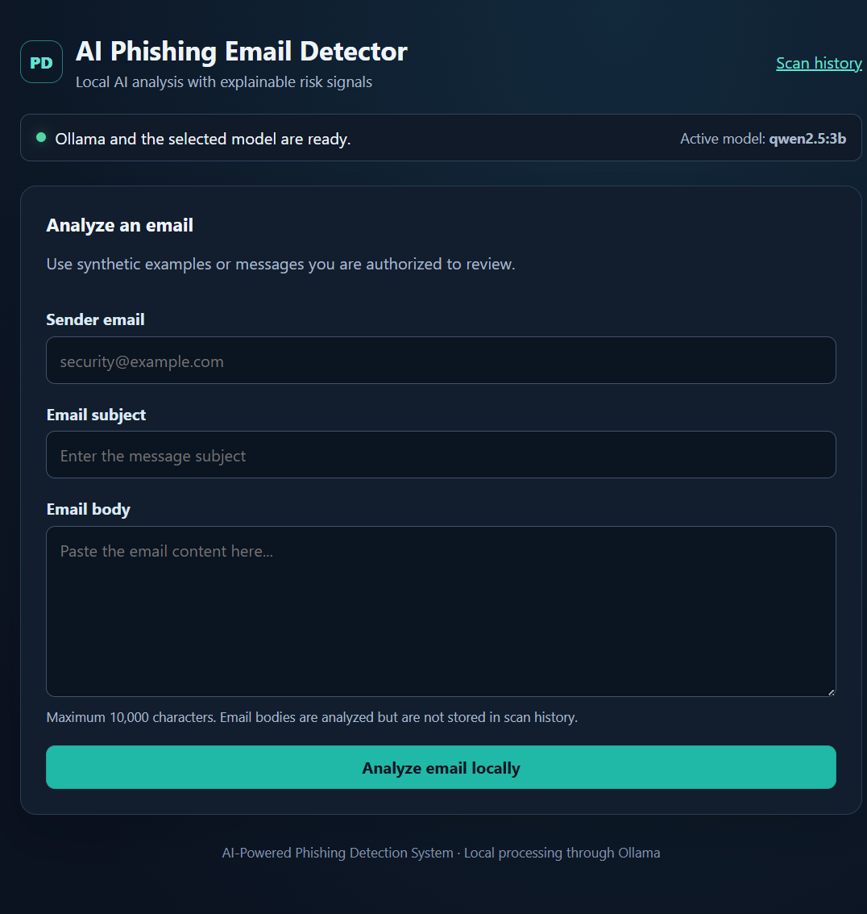
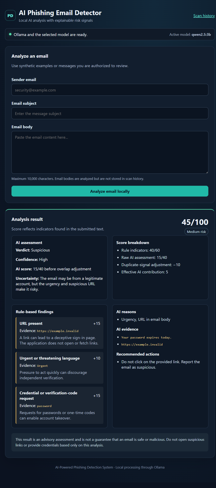
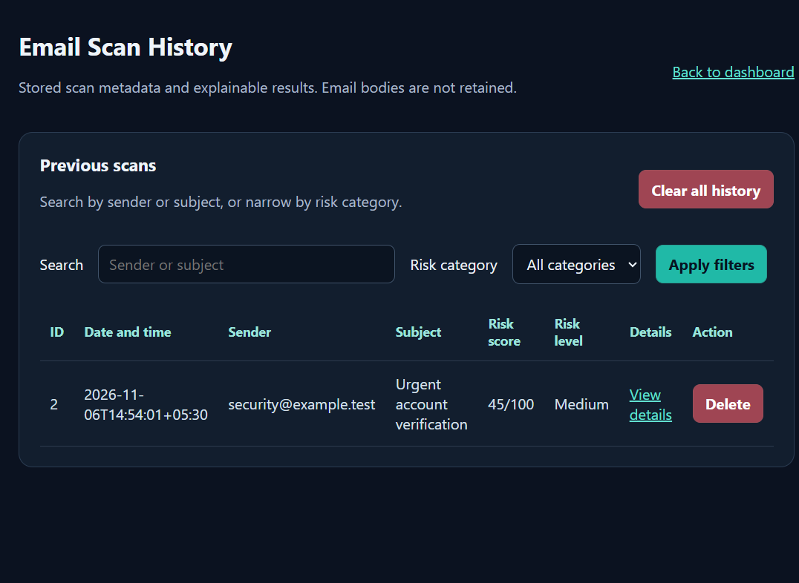

# AI-Powered Phishing Email Detection System

A local-first Flask application for reviewing email text with deterministic phishing indicators and an Ollama language model. It presents an explainable advisory score, keeps scan metadata in SQLite, and never opens email links or sends messages.

The supported web entry point is `app.py`. `main.py` is an earlier interactive console prototype; `app_backup.py` is a preserved legacy snapshot.

## Features

- Accepts sender, subject and body with server-side validation and size limits.
- Checks five distinct indicators: suspicious URLs, urgent language, credential requests, financial requests, and IP-literal or punycode sender domains.
- Requests structured JSON from the local Ollama model (`qwen2.5:3b` by default), validates it, and shows its uncertainty separately from risk.
- Combines rule points (maximum 60) and AI points (maximum 40) into a score from 0 to 100. If the AI identifies an indicator already counted by a rule, 10 AI points are deducted for each reported overlap, up to the raw AI score.
- Stores sender, subject, timestamp, score and findings in SQLite. Email bodies are analyzed in memory and are not saved.
- Provides searchable, filterable history, scan details, CSRF-protected deletion/clear-history forms, and JSON/TXT downloads.
- Shows Ollama/model availability, request errors, and a loading state.

## Risk score

| Score | Category |
|---:|---|
| 0–24 | Low |
| 25–49 | Medium |
| 50–74 | High |
| 75–100 | Critical |

Rule weights are URL `+15`, urgency `+10`, credential request `+15`, financial request `+10`, and unusual sender domain `+10`. Each indicator contributes at most once. The rule subtotal is capped at 60. The model supplies an independently validated score from 0 to 40; each explicitly reported overlapping rule signal reduces that contribution by 10. The final score is the rule subtotal plus the adjusted model contribution. These are transparent educational heuristics, not calibrated security measurements. Model confidence is presented separately and is not added to the risk score.

For example, URL (`15`) + urgency (`10`) + credentials (`15`) + a model score of `30`, with one overlapping AI signal, yields `15 + 10 + (30 - 10) = 45`, or Medium Risk.

## Requirements

- Python 3.11 or later.
- Ollama installed and running on the local machine.
- The `qwen2.5:3b` model, or a compatible locally available model configured through `OLLAMA_MODEL`.

No cloud AI service is used. Local Ollama processing does not by itself secure the host, database, or operating system.

## Install and run (Windows PowerShell)

From the project directory:

```powershell
py -3 -m venv .venv
.\.venv\Scripts\Activate.ps1
python -m pip install --upgrade pip
python -m pip install -r requirements.txt
```

In another terminal, start Ollama and download the default model:

```powershell
ollama serve
ollama pull qwen2.5:3b
```

Start the application:

```powershell
python app.py
```

Open `http://127.0.0.1:5000`. The SQLite database is initialized automatically at `instance/scans.db`; existing databases are extended with nullable columns without deleting scan rows. The Flask development server binds locally by default. Debug mode is off unless `FLASK_DEBUG=1` is explicitly set for local development.

If PowerShell prevents virtual-environment activation, use the interpreter directly:

```powershell
.\.venv\Scripts\python.exe -m pip install -r requirements.txt
.\.venv\Scripts\python.exe app.py
```

## Configuration

Configuration is read from environment variables; a `.env` file loader is not required.

| Variable | Default | Purpose |
|---|---|---|
| `OLLAMA_HOST` | `http://127.0.0.1:11434` | Local Ollama service URL |
| `OLLAMA_MODEL` | `qwen2.5:3b` | Model used for analysis |
| `OLLAMA_TIMEOUT` | `30` | Analysis request timeout in seconds |
| `OLLAMA_STATUS_TIMEOUT` | `2` | Ollama status/model check timeout in seconds |
| `DATABASE_PATH` | `instance/scans.db` | SQLite path; useful for isolated test/development databases |
| `SECRET_KEY` | Random per process | Set a long random value to keep signed sessions stable across restarts |
| `COOKIE_SECURE` | disabled | Set to `1` only when serving over HTTPS |
| `FLASK_DEBUG` | disabled | Set to `1` only for local debugging |

Example PowerShell configuration:

```powershell
$env:SECRET_KEY = "replace-with-a-long-random-value"
$env:OLLAMA_TIMEOUT = "45"
python app.py
```

Do not commit real secrets, live personal emails, or the local scan database.

## Tests

The test suite mocks Ollama and uses temporary SQLite databases, so tests do not require a running model and do not alter `instance/scans.db`.

```powershell
python -m pytest -q
```

See [docs/testing.md](docs/testing.md) for coverage and manual demonstration checks.

## Architecture and workflow

- [docs/architecture.md](docs/architecture.md) describes the frontend, Flask routes, rule engine, Ollama and SQLite responsibilities.
- [docs/workflow.md](docs/workflow.md) shows the scan and history flows.

## Screenshots

The screenshots show a synthetic example. Its demo scan was removed after capture; the working database contains no scan records.







## Privacy and safety

- Use synthetic samples or messages you are explicitly authorized to analyze.
- Email bodies are sent to the configured Ollama endpoint. If a remote endpoint is configured, the email body leaves the local device.
- Sender, subject, findings, score, model explanation and timestamp are stored in the local database until deleted.
- The application never follows links, downloads attachments, submits credentials, or sends email.
- Text-only checks cannot inspect email headers, attachment contents, link destinations, or sender authentication records.
- The local indicator weights and model scores are educational heuristics and are not calibrated security measurements.
- Treat the local database as sensitive, keep it out of source control, and delete records when they are no longer needed.

## Limitations

- Text-only checks cannot inspect email headers, attachment contents, actual link destinations, or sender authentication records.
- Rule matches and model analysis can produce false positives and false negatives; a suspicious message can also be missed.
- The risk score is an advisory heuristic, not a probability, validated security standard, or guarantee that a message is safe or malicious.
- Local Ollama processing reduces external transmission but does not secure the device, operating system, database, or any non-local Ollama endpoint selected in configuration.

## Submission checklist

- [ ] Run the automated tests and record the actual result.
- [ ] Start the application with the documented local Ollama model.
- [ ] Demonstrate authorized synthetic examples, risk explanations, history filters, deletion and both report formats.
- [x] Capture screenshots from the running application for the final submission.
- [ ] Inspect repository contents for secrets and personal data before sharing.
- [ ] Create/push a GitHub repository only after reviewing and approving its contents.

## GitHub preparation

Suggested repository name: `ai-phishing-email-detector`

Suggested description: `Local-first phishing email analysis dashboard using Flask, Ollama, explainable detection rules, and SQLite.`

The project has not been published. After installing Git for Windows, run these commands from the project directory and review the staged list before creating a commit:

```powershell
git --version
git init -b main
git check-ignore -v instance\scans.db
git add .gitignore README.md requirements.txt app.py app_backup.py main.py templates tests docs screenshots
git status --short
git diff --cached --check
git diff --cached --name-only
git commit -m "Prepare phishing detector project for submission"
```

Confirm that the staged file list contains no database, virtual environment, `.env`, cache, or personal data before committing. Add a GitHub remote and push only after reviewing the repository contents and choosing a public/private visibility setting.
