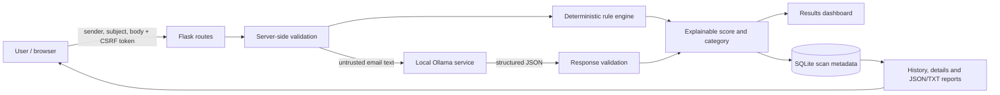

# System architecture

The application keeps analysis local: the browser sends a form to Flask, Flask validates the fields, runs deterministic rules and requests structured JSON from the configured Ollama service. Only validated results are scored and persisted. SQLite stores scan metadata and findings, not email bodies.

## Component responsibilities

- **Browser templates:** collect email text, show local service status, provide accessible analysis/loading/error/results views, and submit CSRF tokens for state-changing requests.
- **Flask application (`app.py`):** validate and normalize inputs, enforce request-size and CSRF checks, orchestrate analysis, render routes, report errors, and safely access SQLite using parameterized values.
- **Rule engine:** identify URL, urgency, credential, financial, and unusual sender-domain indicators. Each signal contributes at most once and exposes its evidence and weight.
- **Ollama:** analyze the untrusted email text locally and return the validated verdict, reasons, evidence, uncertainty, recommendations, confidence and AI score.
- **Scoring:** add the rule subtotal to the model score after deducting points for AI-reported overlaps. Confidence is displayed separately from risk.
- **SQLite:** preserve scan timestamp, sender, subject, score, category and findings; migration adds nullable analysis fields to existing databases without discarding rows. The submitted email body is not stored.

## Trust boundaries and privacy

Treat email content and model responses as untrusted. Do not follow URLs. Jinja templates escape interpolated values; SQL values are parameterized. Local processing does not secure the device or database. Keep `instance/*.db`, secrets and real message content out of source control.
